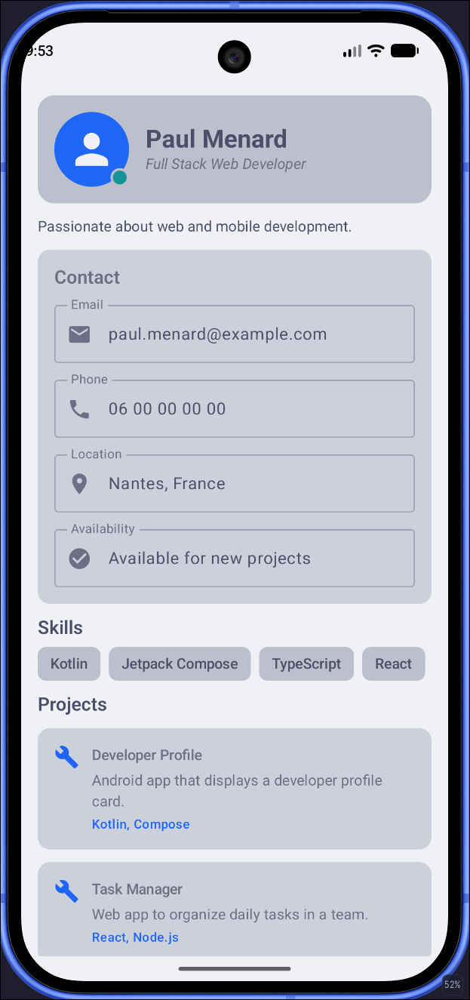
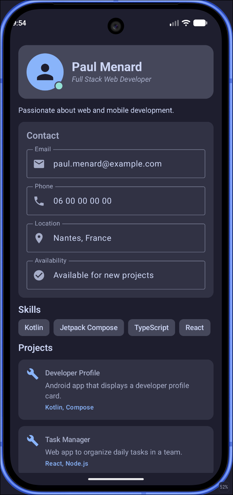

# Compose Developer Profile

> **Note:** this repository contains the second assignment (UI improvements).
> The first assignment is available at the [`CC1`](../../tree/CC1) tag.

## Description

This Android app, built with Jetpack Compose and Material Design 3, displays the profile of a developer.
The screen shows:

- a header with a placeholder avatar, an availability badge, the developer's name and job title;
- a short description;
- a contact card (email, phone, location and availability);
- a horizontal list of skills;
- a list of projects;
- two action buttons: "Contact" and "Portfolio".

All the data is local: it is written directly in Kotlin in `data/DevProfile.kt`.
The buttons do not trigger a real action, their callbacks are empty.

## Compose components used

| Component | Where |
|---|---|
| `Text` | Name, title, description, section titles, skills, projects |
| `Button` / `OutlinedButton` | "Contact" and "Portfolio" actions in `ActionButtons` |
| `Icon` | Contact fields, project cards and action buttons |
| `Image` | Placeholder avatar in `ProfileAvatar` |
| `Card` | `ContactInfoCard` and `ProjectCard` |
| `OutlinedTextField` (read-only) | `InfoField`, used for email, phone, location and availability |
| `Surface` | Screen background, header zone and `SkillChip` |
| `Scaffold` | Root of the screen in `MainActivity` |

## Layouts used

| Layout | Where |
|---|---|
| `Column` | Header texts, contact card, skills section, project card texts |
| `Row` | Header (avatar + texts), project card (icon + texts), action buttons |
| `Box` | `ProfileAvatar`: the availability badge is drawn on top of the avatar |
| `Spacer` | Space between the avatar and the texts, between icons and texts |
| `Surface` | Colored zone around the header, using the theme colors and shapes |
| `LazyColumn` | The whole screen |
| `LazyRow` | The list of skills |

## Lists with LazyColumn and LazyRow

- **`LazyColumn`** (`ProfileContent`) is the main layout of the screen, so the whole screen can scroll.
  Each section is added with `item { ... }`.
  The projects are added with `items(profile.projects) { project -> ProjectCard(project) }`:
  each project is displayed by the reusable `ProjectCard` composable.
- **`LazyRow`** (`SkillsSection`) displays the skills horizontally with `items(skills) { skill -> SkillChip(skill) }`.
  When there are too many skills for the screen width, the row scrolls horizontally.

Lazy lists only compose the items that are visible on screen, so they stay efficient even with long lists.

## Theme choices

The theme is defined in `ui/theme/` and uses the [Catppuccin](https://catppuccin.com/palette) palettes:

- **Light theme**: Catppuccin Latte;
- **Dark theme**: Catppuccin Mocha.

The theme follows the system setting with `isSystemInDarkTheme()`.
Both color schemes map the Catppuccin colors to the same Material 3 roles:
`primary` is Blue, `secondary` is Teal, `tertiary` is Mauve, `background` and `surface` are Base, text is Text, etc.

The theme also customizes:

- **`MaterialTheme.typography`** (`Type.kt`): `headlineSmall` (bold) for the name, `titleMedium` (semi-bold) for section titles;
- **`MaterialTheme.shapes`** (`Shape.kt`): `small` (8 dp) for skill chips, `medium` (12 dp) for cards, `large` (16 dp) for the header.

Components never use hard-coded colors: they always use `MaterialTheme.colorScheme`, so both themes work automatically.

## Screenshots

| Light theme | Dark theme |
|---|---|
|  |  |

## Which Compose UI notions did you reuse in this app?

- **Basic components**: `Text`, `Button`, `OutlinedButton`, `Icon`, `Image`, `Card` and a read-only `OutlinedTextField`.
- **Layouts**: `Column`, `Row`, `Box` (avatar with a badge), `Spacer` and `Surface`.
- **Lazy lists**: a `LazyColumn` for the whole screen and the projects, and a `LazyRow` for the skills.
- **Reusable cards**: `ProjectCard`, `SkillChip`, `InfoField` and `ContactInfoCard` get their data as parameters and accept a `Modifier`.
- **Material Design 3**: a custom `colorScheme`, `typography` and `shapes`.
- **Light / dark theme**: two color schemes (Catppuccin Latte and Mocha), and previews for both themes.
- **Previews**: light theme, dark theme and an unavailable profile.
