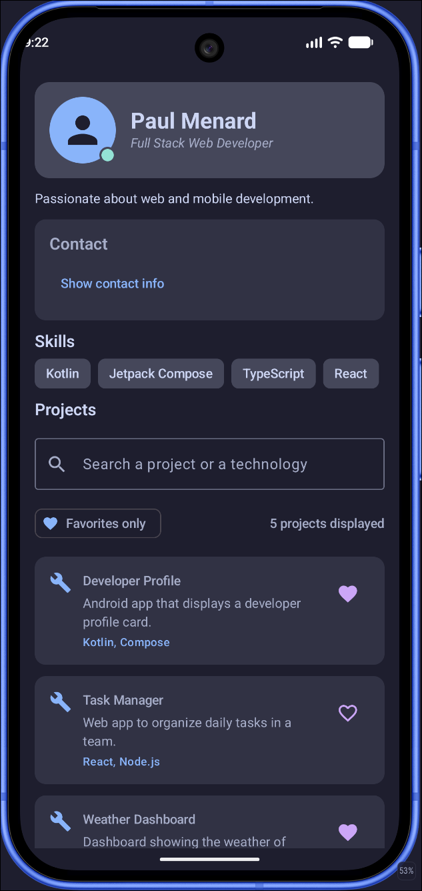
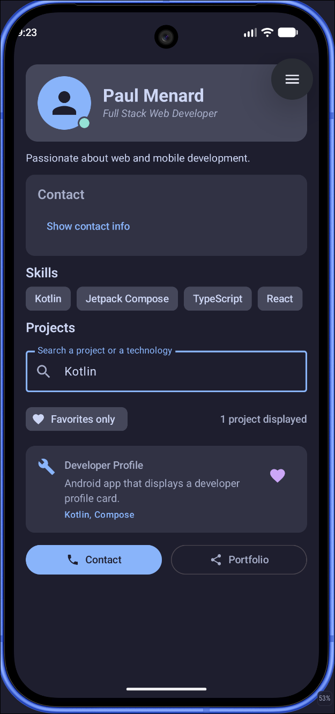

# Interactive Developer Profile

> **Note:** this repository contains the third assignment (state management).
> The first assignment is available at the [`CC1`](../../tree/CC1) tag.
> The second assignment is available at the [`CC2`](../../tree/CC2) tag.

## Description

This Android app, built with Jetpack Compose and Material Design 3, displays the profile of a developer
as a small interactive portfolio.

The screen shows the developer's header, description, contact card, skills, projects and action buttons.
The user can now:

- search a project by its name, its description or a technology;
- add a project to the favorites, or remove it, with the heart icon;
- display all the projects, or only the favorite ones, with the "Favorites only" chip;
- see the number of projects currently displayed ("5 projects displayed", "1 project displayed"...);
- show or hide the contact information.

All the data stays local: it is written directly in Kotlin in `data/DevProfile.kt`.

## States managed by the app

The main state of the screen is grouped in `ProfileUiState` and managed by `ProfileViewModel`:

| State | Type | Role |
|---|---|---|
| `profile` | `DevProfile` | Data of the developer (name, skills, projects...) |
| `searchQuery` | `String` | Text typed in the search field |
| `showOnlyFavorites` | `Boolean` | Whether the "Favorites only" filter is active |
| `favoriteProjectIds` | `Set<Int>` | Ids of the projects marked as favorites |
| `projects` | `List<Project>` | Projects displayed, after the search and the favorites filter |

## Local state

The `showDetails` state of `ContactInfoCard`, which shows or hides the contact information:

```kotlin
var showDetails by rememberSaveable { mutableStateOf(false) }
```

It is only a display detail of this card: no other part of the screen needs it, and it does not change
the data of the app. Putting it in the ViewModel would add code without any benefit.
I used `rememberSaveable` instead of `remember` so the value is kept when the screen is rotated.

## State Hoisting

`DeveloperProfileScreen` does not create or store any state. It receives:

- the values to display, with the `uiState: ProfileUiState` parameter;
- the user actions, as callbacks: `onSearchQueryChange`, `onToggleFavoriteFilter` and `onFavoriteClick`.

When the user types in the search field or clicks on a heart, the screen only calls the callback.
It does not decide how the state is stored or updated: this is the job of the ViewModel.
Thanks to this, the screen can be displayed in a preview with any state, without a ViewModel.

## ViewModel

`ProfileViewModel` owns the main state of the screen and contains the actions of the user:

- `onSearchQueryChange(query)` updates the search text;
- `onToggleFavoriteFilter()` turns the "Favorites only" filter on or off;
- `onFavoriteClick(projectId)` adds the project to the favorites, or removes it if it is already one.

After each action, it computes again the list of displayed projects (search + favorites filter)
and publishes the new state. The ViewModel does not depend on any Compose UI component.
It also survives configuration changes, like a screen rotation, so the search and the favorites are not lost.

## StateFlow

The ViewModel keeps a private `MutableStateFlow<ProfileUiState>` that only it can modify,
and exposes a public read-only `StateFlow<ProfileUiState>`.

In `ProfileContainer`, the state is collected with `collectAsState()`.
Each time the ViewModel puts a new value in the `StateFlow`, `collectAsState()` receives it,
and Compose recomposes the screen with this new state.

```
ViewModel ──publishes a state──▶ ProfileContainer ──passes the state──▶ DeveloperProfileScreen
    ▲                                                                       │
    └──────────────────────── event (callback) ─────────────────────────────┘
```

## Code organization

| Element | Role |
|---|---|
| `MainActivity` | Entry point: applies the theme and displays `ProfileContainer` in a `Scaffold` |
| `data/DevProfile.kt` | Local data: `DevProfile` and `Project` |
| `ui/ProfileUiState` | Data class grouping the main state of the screen |
| `ui/ProfileViewModel` | Manages the state, the user actions and the filtering of the projects |
| `ui/ProfileContainer` | Gets the ViewModel, collects the `StateFlow` and passes the state and callbacks to the screen |
| `ui/DeveloperProfileScreen` | Stateless screen, and its previews |
| `ui/components/ProfileHeader` | Header with the avatar, name, title and description |
| `ui/components/ContactInfoCard` | Contact card, with the local show / hide state |
| `ui/components/SkillsSection` | Horizontal list of skills |
| `ui/components/ProjectsSection` | Search field, favorites filter with the project count, and `ProjectCard` |
| `ui/components/ActionButtons` | "Contact" and "Portfolio" buttons |
| `ui/theme/` | Material 3 theme (Catppuccin Latte and Mocha colors, typography, shapes) |

## Screenshots

| Default | Search and favorites |
|---|---|
|  |  |
