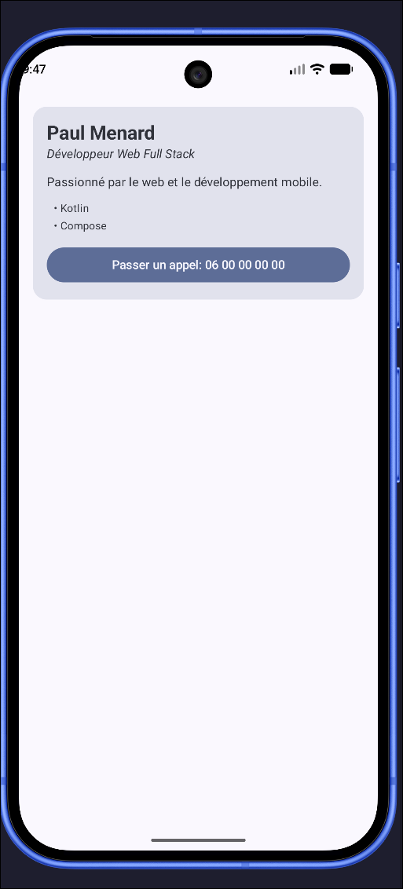

# Compose Developer Profile

## Description

This app displays a developer's profile card built with Jetpack Compose.
The card shows the developer's name and job title, a short description, and a list of skills.
At the bottom, a "call" button shows the developer's phone number. It is enabled only when the developer is available.
The data comes from a `DevProfile` data class, so the same card can show any developer.

## Compose concepts used

- **Composables**: the UI is split into small `@Composable` functions.
- **Parameters**: each composable gets its data (`name`, `title`, `skills`, `isAvailable`, ...) as parameters.
- **Modifiers**: every composable accepts an optional `modifier: Modifier = Modifier`. The code also uses `padding`, `fillMaxWidth`, `fillMaxSize` and `background`.
- **Outer / inner padding**: `ProfileCard` adds padding before and after `background()`.
- **Callbacks**: `Button(onClick = ...)` in `ContactButton`.
- **Previews**: three `@Preview` functions (full screen, available profile, unavailable profile).
- **Basic accessibility**: real text labels, a disabled state that is announced, and theme typography.
- **Layouts**: `Scaffold`, `Surface`, `Column` with `Arrangement.spacedBy`.
- **Material 3 theming**: `MaterialTheme.colorScheme` and `MaterialTheme.typography`.

## Short explanation

**1. Which composables did you create?**
`DeveloperProfileScreen`, `ProfileCard`, `ProfileHeader`, `ProfileDescription`, `ProfileSkill`, `ContactButton`, and three previews: `DeveloperProfileScreenPreview`, `ProfileCardPreview` and `ProfileCardNotAvailablePreview`.

**2. Which composable is the main screen?**
`DeveloperProfileScreen`. `MainActivity` calls it inside a `Scaffold` and passes it the `innerPadding` from the Scaffold.

**3. Where do you use outer padding?**
In `ProfileCard`, the first `.padding(16.dp)` comes **before** `.background(...)`. It creates space around the card, between the card and the screen edges. `ProfileSkill` also uses `padding(start = 8.dp)` to indent each skill.
I also managed outer padding using `verticalArrangement`, which is a regular spacing between elements.

**4. Where do you use inner padding?**
In `ProfileCard`, the second `.padding(16.dp)` comes **after** `.background(...)`. It creates space inside the rounded card, between its edge and the text.

**5. Which component receives a callback?**
The Material `Button` in `ContactButton` receives the `onClick` callback, which is meant to start the phone call. The button is enabled only when `isAvailable` is `true`.

**6. What accessibility information did you add?**
- The button label is real text (`"Passer un appel: <number>"`), so TalkBack reads what the button does and which number it calls.
- `enabled = isAvailable` means TalkBack announces the button as *disabled* when the developer is unavailable.
- All information is shown as `Text` (no icon without a label), so screen readers can read everything.

**7. Why can your components be considered reusable?**
- Each composable gets its data through parameters instead of hard-coded values.
- Each one accepts an optional `Modifier`, so the caller can change its size and position.
- `ProfileCard` takes a `DevProfile` object. The previews show the same card with two different profiles (`getDevProfile()` and `getExpertDevProfile()`).
- Each component does one job (header, description, skill, button), so they can be reused in other screens.

## Screenshot

